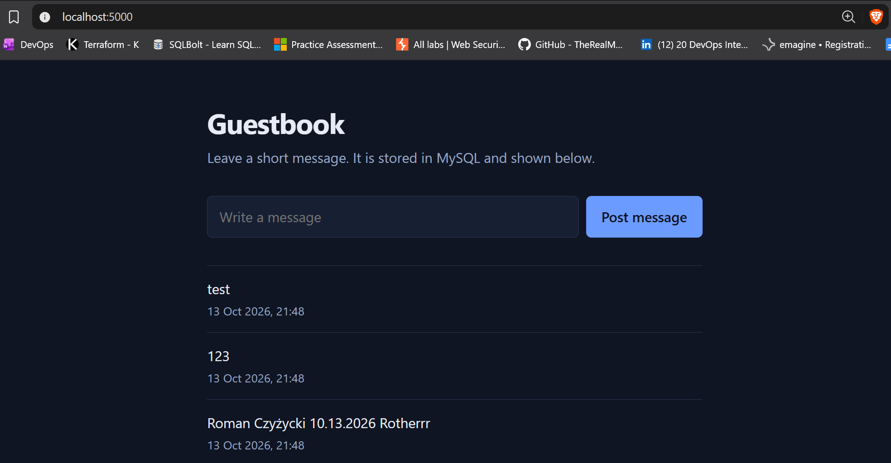
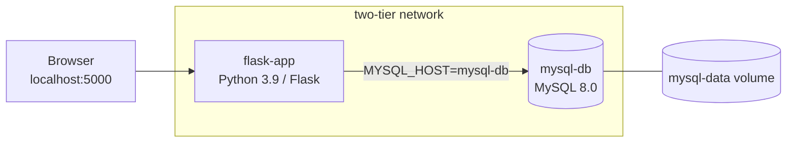
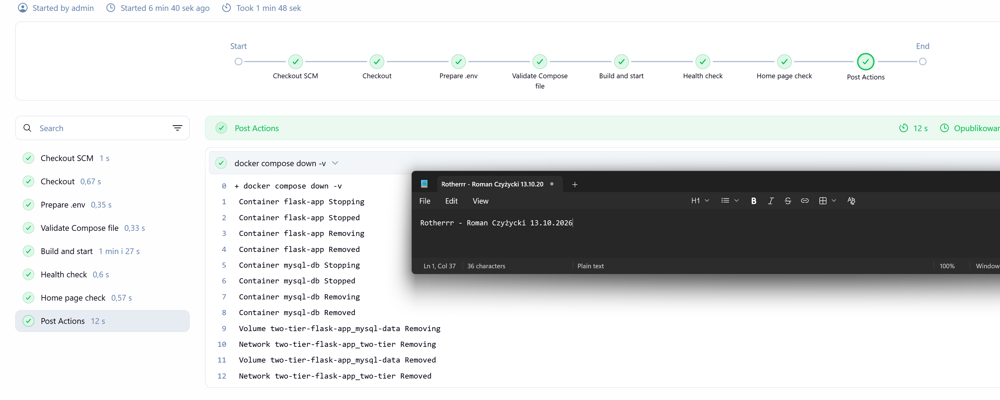

# Two-Tier Flask App: Docker Compose + CI/CD

[](https://github.com/Rotherrr/DevOps-Project-Automated-CI-CD-Pipeline/actions/workflows/main.yml)

A small guestbook app (Flask + MySQL) that I built to practise the DevOps side of a project: containers, config and secrets, healthchecks, and automated build-and-test pipelines. The app is deliberately simple. The interesting part is how it's packaged, started and verified.

The whole stack runs with one command. Every push to `main` is built and smoke-tested by GitHub Actions, and the same checks run in a Jenkins pipeline that I host locally in Docker.



## What this project shows

- **Multi-container setup with Docker Compose**: Flask app and MySQL 8.0 on a private bridge network, talking to each other by service name.
- **Reliable startup order**: both services have healthchecks, and the app waits for the database with `depends_on: condition: service_healthy` instead of `sleep` or retry hacks.
- **No secrets in the repo**: all credentials come from `.env` (git-ignored); only `.env.example` is committed.
- **Persistent data**: MySQL data lives in a named Docker volume and survives container restarts.
- **Automatic DB initialisation**: `message.sql` creates the table and seed data on first start.
- **CI/CD, implemented twice**: GitHub Actions (cloud) and a Jenkinsfile (self-hosted), running the same checks.
- **Jenkins in Docker**: the Jenkins server itself is containerised (with a Docker-in-Docker daemon), so nothing has to be installed on the host.
- **Smoke tests in the pipeline**: a build only passes if `/health` and the home page both respond successfully.

## Quick start

You need Docker with Compose v2 and Git.

```bash
git clone https://github.com/Rotherrr/DevOps-Project-Automated-CI-CD-Pipeline.git
cd DevOps-Project-Automated-CI-CD-Pipeline

cp .env.example .env        # then set your own passwords in .env
docker compose up -d --build
```

Open http://localhost:5000, or check the health endpoint:

```bash
curl http://localhost:5000/health
# {"status": "healthy"}
```

The first start takes up to a minute while MySQL initialises. Stop everything with `docker compose down`; add `-v` to also delete the database volume.

> On Windows PowerShell, use `curl.exe` instead of `curl`.

## Architecture



1. The browser talks to the `flask-app` container on port 5000.
2. Flask reads its DB settings from environment variables and connects to `mysql-db` over the internal network.
3. MySQL stores everything in the `devops` database, backed by the `mysql-data` volume.
4. On the very first start, MySQL runs `message.sql` from `/docker-entrypoint-initdb.d/`.

## Configuration

Copy `.env.example` to `.env` and fill in your own values.

| Variable              | Purpose                                  |
| --------------------- | ---------------------------------------- |
| `MYSQL_HOST`          | Database host (the Compose service name) |
| `MYSQL_USER`          | Application database user                |
| `MYSQL_PASSWORD`      | Password for that user                   |
| `MYSQL_DB`            | Database name (`devops`)                 |
| `MYSQL_ROOT_PASSWORD` | Root password for the MySQL container    |

## Endpoints

| Method | Path      | Description                                   |
| ------ | --------- | --------------------------------------------- |
| GET    | `/`       | Message form and list of saved messages       |
| POST   | `/`       | Save a new message                            |
| GET    | `/health` | Returns `{"status": "healthy"}` with HTTP 200 |

`/health` only reports that the app process is alive. Database health is covered by the MySQL healthcheck in Compose, and the pipelines additionally request the home page, which needs the database.

## CI/CD

Both pipelines run the same checks:

1. Check out the code
2. Create `.env` from `.env.example` (throwaway credentials for a short-lived test stack)
3. Validate the Compose file (`docker compose config`)
4. Build and start the stack (`docker compose up -d --build`)
5. Poll `/health` until the app answers, for up to 30 tries
6. Request the home page, which fails the build on an HTTP 500
7. Show the container logs on failure, then always tear the stack down

### GitHub Actions

[`.github/workflows/main.yml`](.github/workflows/main.yml) runs on every push to `main` (and can be started manually).

### Jenkins

[`Jenkinsfile`](Jenkinsfile) defines the same pipeline in Jenkins. The health checks run inside the app container (`docker compose exec`), so they also work when Jenkins itself runs in a container and cannot reach the host's `localhost`.



#### Running Jenkins locally

Jenkins runs in Docker next to a separate Docker-in-Docker daemon. Nothing is installed on your machine, and the pipeline's containers live inside that daemon, so they never clash with your own containers or ports.

```bash
cd jenkins
docker compose up -d --build

# initial admin password
docker compose exec jenkins cat /var/jenkins_home/secrets/initialAdminPassword
```

1. Open http://localhost:8080, enter the password and install the suggested plugins.
2. Create a new item of type **Pipeline**.
3. Under *Pipeline*, choose **Pipeline script from SCM**, set SCM to **Git**, enter this repository's URL, set the branch to `*/main` and the script path to `Jenkinsfile`.
4. Save and click **Build Now**. The first run is slow because the inner daemon has to pull the MySQL and Python images.
5. Optional: under *Triggers*, enable **Poll SCM** with the schedule `H/2 * * * *`. Jenkins then checks the repository every couple of minutes and builds on new commits, with no public webhook endpoint needed.

Stop it with `docker compose down` in the `jenkins/` folder (add `-v` to also delete Jenkins' data).

Jenkins only builds while it is running locally. A GitHub webhook would trigger builds instantly, but it needs a publicly reachable Jenkins, which I didn't want for a local setup. GitHub Actions covers the build-on-every-push case in the cloud.

## Design decisions

- **Healthchecks over sleeps.** A fixed delay is either too short (flaky builds) or too long (slow builds). Waiting on the database's real health state is faster and more predictable.
- **MySQL healthcheck over TCP.** During first-time initialisation, MySQL runs a temporary server without networking. Pinging `127.0.0.1` only succeeds once the real server is up, so the app doesn't start against a half-initialised database.
- **`.env` instead of hardcoded values.** The same Compose file works on any machine, and nothing sensitive ends up in Git history.
- **`python:3.9-slim`.** Small image, quick builds, fewer packages to patch. It has no `curl`, so the container healthcheck uses Python itself.
- **Database not exposed to the host.** MySQL is reachable only from inside the Compose network.
- **Separate Docker-in-Docker daemon for Jenkins.** Mounting the host's Docker socket would be simpler, but bind mounts like `./message.sql` would then resolve against the host instead of the Jenkins workspace. A dedicated daemon sharing the Jenkins volume avoids that and keeps pipeline containers isolated.
- **Home page check on top of `/health`.** `/health` stays green even if the template or the database is broken. Requesting `/` catches those cases.

## Known limitations

This is a learning project, so a few things are intentionally left out:

- The app runs on Flask's built-in server. A production setup would use Gunicorn behind a reverse proxy.
- There are no automated unit tests yet; the pipelines verify that the stack starts and the pages respond.
- Images are not scanned for vulnerabilities or pushed to a registry.
- The Jenkins setup is meant for local use: it has no HTTPS, no webhook and a single admin user.

## Project structure

```text
.
├── .github/workflows/main.yml   # GitHub Actions pipeline
├── docs/                        # Screenshots used in this README
├── jenkins/                     # Local Jenkins (Docker) for running the Jenkinsfile
│   ├── Dockerfile
│   └── docker-compose.yml
├── templates/index.html         # UI
├── .dockerignore
├── .env.example                 # Environment variable template
├── .gitignore
├── Dockerfile                   # Flask app image
├── Jenkinsfile                  # Jenkins pipeline
├── app.py                       # Flask app
├── docker-compose.yml           # Flask + MySQL
├── message.sql                  # DB schema and seed data
└── requirements.txt
```

## Troubleshooting

- **Port 5000 already in use**: change the port mapping in `docker-compose.yml`, e.g. `5001:5000`.
- **Port 8080 already in use when starting Jenkins**: another Jenkins or service is using it. Stop that one, or change the mapping in `jenkins/docker-compose.yml`, e.g. `8081:8080`.
- **`TemplateNotFound: index.html`**: `templates/` must sit next to `app.py`, and the image has to be rebuilt after moving it (`docker compose up -d --build`).
- **Edits to `message.sql` have no effect**: init scripts only run on an empty database. Run `docker compose down -v` and start again.
- **`Access denied` from MySQL**: the credentials in `.env` must match the ones the database was first created with. After changing them, remove the volume as above.
- **Jenkins says it can't find the `Jenkinsfile`**: the file has to be committed and pushed to the branch the job builds, because Jenkins reads it from GitHub, not from your disk.

## Author

<Your Name> · [GitHub](https://github.com/Rotherrr) · [LinkedIn](https://www.linkedin.com/in/<your-profile>)
