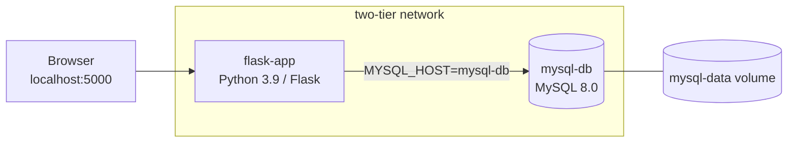

# DevOps-Project-Automated-CI-CD-Pipeline

# Two-Tier Flask App: Docker Compose + CI/CD

[](https://github.com/<your-username>/devops-two-tier-flask-app/actions/workflows/main.yml)

A small guestbook app (Flask + MySQL) that I built to practise the DevOps side of a project: containers, config and secrets, healthchecks, and automated build-and-test pipelines. The app is deliberately simple. The interesting part is how it's packaged, started and verified.

The whole stack runs with one command, and every push to `main` is built and smoke-tested automatically.

## What this project shows

- **Multi-container setup with Docker Compose**: Flask app and MySQL 8.0 on a private bridge network, talking to each other by service name.
- **Reliable startup order**: both services have healthchecks, and the app waits for the database with `depends_on: condition: service_healthy` instead of `sleep` or retry hacks.
- **No secrets in the repo**: all credentials come from `.env` (git-ignored); only `.env.example` is committed.
- **Persistent data**: MySQL data lives in a named Docker volume and survives container restarts.
- **Automatic DB initialisation**: `message.sql` creates the table and seed data on first start.
- **CI/CD, implemented twice**: GitHub Actions (cloud) and a Jenkinsfile (self-hosted), running the same steps.
- **Smoke test in the pipeline**: the build only passes if `GET /health` returns HTTP 200.

## Quick start

You need Docker with Compose v2 and Git.

```bash
git clone https://github.com/<your-username>/devops-two-tier-flask-app.git
cd devops-two-tier-flask-app

cp .env.example .env        # then set your own passwords in .env
docker compose up -d --build
```

Open http://localhost:5000, or check the health endpoint:

```bash
curl http://localhost:5000/health
# {"status": "healthy"}
```

Stop everything with `docker compose down`. Add `-v` to also delete the database volume.

## Architecture



1. The browser talks to the `flask-app` container on port 5000.
2. Flask reads its DB settings from environment variables and connects to `mysql-db` over the internal network.
3. MySQL stores everything in the `devops` database, backed by the `mysql-data` volume.
4. On the very first start, MySQL runs `message.sql` from `/docker-entrypoint-initdb.d/`.

## Configuration

Copy `.env.example` to `.env` and fill in your own values.

| Variable              | Purpose                                  |
| --------------------- | ---------------------------------------- |
| `MYSQL_HOST`          | Database host (the Compose service name) |
| `MYSQL_USER`          | Application database user                |
| `MYSQL_PASSWORD`      | Password for that user                   |
| `MYSQL_DB`            | Database name (`devops`)                 |
| `MYSQL_ROOT_PASSWORD` | Root password for the MySQL container    |

## Endpoints

| Method | Path      | Description                                  |
| ------ | --------- | -------------------------------------------- |
| GET    | `/`       | Message form and list of saved messages      |
| POST   | `/`       | Save a new message                           |
| GET    | `/health` | Returns `{"status": "healthy"}` with HTTP 200 |

## CI/CD

Both pipelines do the same thing:

1. Check out the code
2. Validate the Compose file (`docker compose config`)
3. Build and start the stack (`docker compose up -d --build`)
4. Wait a few seconds, then call `curl http://localhost:5000/health`
5. Tear everything down

- **GitHub Actions**: [`.github/workflows/main.yml`](.github/workflows/main.yml), triggered on every push to `main`.
- **Jenkins**: [`Jenkinsfile`](Jenkinsfile), for a local or self-hosted Jenkins agent that has Docker installed.

## Design decisions

- **Healthchecks over sleeps.** A fixed delay is either too short (flaky builds) or too long (slow builds). Waiting on the database's real health state is faster and more predictable.
- **`.env` instead of hardcoded values.** The same Compose file works on any machine, and nothing sensitive ends up in Git history.
- **`python:3.9-slim`.** Small image, quick builds, fewer packages to patch.
- **Database not exposed to the host.** MySQL is reachable only from inside the Compose network.

## Known limitations

This is a learning project, so a few things are intentionally left out:

- The app runs on Flask's built-in server. A production setup would use Gunicorn behind a reverse proxy.
- There are no automated unit tests yet; the pipeline only verifies that the stack starts and `/health` responds.
- Images are not scanned for vulnerabilities or pushed to a registry.

## Project structure

```text
.
├── .github/workflows/main.yml   # GitHub Actions pipeline
├── templates/index.html         # UI
├── .env.example                 # Environment variable template
├── .gitignore
├── Dockerfile                   # Flask app image
├── Jenkinsfile                  # Jenkins pipeline
├── app.py                       # Flask app
├── docker-compose.yml           # Flask + MySQL
├── message.sql                  # DB schema and seed data
└── requirements.txt
```

## Troubleshooting

- **Port 5000 already in use**: change the port mapping in `docker-compose.yml`, e.g. `5001:5000`.
- **Edits to `message.sql` have no effect**: init scripts only run on an empty database. Run `docker compose down -v` and start again.
- **`Access denied` from MySQL**: the credentials in `.env` must match the ones the database was first created with. After changing them, remove the volume as above.

## Author

<Your Name> · [GitHub](https://github.com/<your-username>) · [LinkedIn](https://www.linkedin.com/in/<your-profile>)
